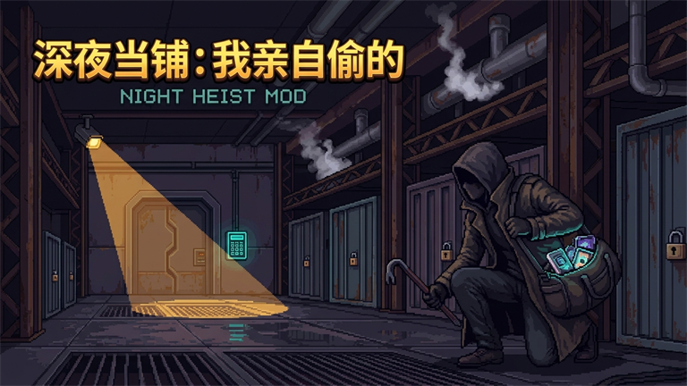

# 深夜当铺：我亲自偷的 / Night Heist



为《深空当铺：可能是偷的》（*Probably Stolen*）制作的原生 C# 模组。在夜间外出地图中新增**「寻找机会 / Scout Opportunities」**活动（不替换原版垃圾场 / 配给站 / 博士店，共用每晚一次外出机会），让玩家亲自出门踩点、挑选目标并带回赃物。

---

## 核心玩法 / Features

- **90% 概率踩点成功**：按权重从 **食品供货商（食物窃贼）**、**小偷小摸（扒手）**、**治安部 / 建筑部 / 服务部 / 医疗部 / 指挥部（窃贼）** 中无放回抽取 **2 个目标**，由玩家选择下手或直接**放弃行动安全撤离**（无惩罚）。
- **10% 概率巡逻封锁**：触发「悻悻而归，今天治安部加强了巡逻」，并有 35% 概率被巡逻发现扣除治安官声望（默认 `-3`）。
- **原版完整掉落表**：产物完全复用游戏对应 NPC 的掉落逻辑；解锁赃物机制后附带原版赃物热度（食物窃贼固定 `25`，不扣减配给站库存）。
- **犯罪记录联动**：解锁治安档案机制（`isSecurityRecordIntroduced`）后，盗窃得手将按 **赃物基础总价值 × 1.5** 记入专属罪名 **「盗窃 / Theft」**（正常参与证据度增长、每日衰减与关系人洗白）。
- **专属像素美术 & 中英双语**：内置定制站点卡片与夜间场景背景，支持简体中文 / 繁体中文 / 英文自动切换，所有概率、权重、声望扣减与犯罪倍率均可在游戏内 **模组设置（ModConfig）** 中自由调整。

---

## 安装方法 / Installation

### 方式一：Steam 创意工坊（推荐）
直接在 Steam 创意工坊搜索 **「深夜当铺：我亲自偷的 / Night Heist」** 订阅，并在游戏主菜单 **Mods** 界面启用后重启游戏即可。

### 方式二：手动安装
1. 从 [Releases](../../releases) 下载打包好的 `NightHeist` 文件夹（或自行编译）。
2. 将其放入游戏根目录的 `Mods/` 文件夹下（确保路径为 `Probably Stolen/Mods/NightHeist/manifest.xml`）。
3. 启动游戏，在主菜单 **Mods** 中勾选启用并重启游戏。

---

## 自行编译 / Building from Source

本模组仅依赖 .NET Framework 自带 `csc.exe` 与游戏本体 `Managed/` 目录下的程序集，无需安装 Visual Studio：

```powershell
# 在 PowerShell 中运行，传入你的游戏安装目录
.\build.ps1 -GameDir "D:\SteamLibrary\steamapps\common\Probably Stolen"
```

编译产物会输出到 `build/NightHeist.dll`，并自动部署到游戏 `Mods/NightHeist/` 目录。

---

## 开源协议 / License

本项目基于 [MIT License](LICENSE) 开源。
